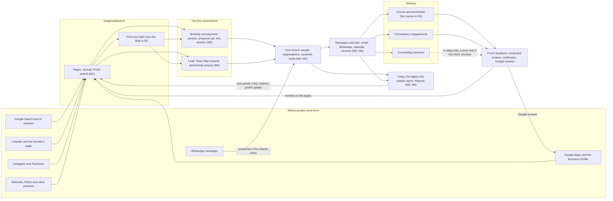

# 15 · Operating system (every system that runs, sells and grows IIIC)

Every system IIIC needs to manage, run and grow the business digitally, the website being one of them: what each does for the business, what is live, what comes next and in which milestone, which tool or template it uses and why, who runs it, and which number it moves. Written 22 November 2026 against `main` at the merge of PR #30 (the search system). Vendor prices and product facts were checked on the web that day and are cited in § Sources; they change often, so re-check them before signing up. This document restates `00`–`14` for planning; where it differs from them, they and `decisions.md` win until IIIC confirms the OS proposal behind the difference. The proposals in §8 (OS-1 to OS-14) wait for IIIC, and nothing that depends on one is built before it is decided.

## 1. The one idea: one platform, one record

IIIC is to run on one platform. Every client, lead, booking, payment, consent, Map result and story will live in one database in Mumbai, in IIIC's own accounts (`14` §2, the first bet; D-35). The tools around the platform carry messages or money for it, or hold what the law says they must hold; none keeps a second copy of the client record.

Why not a stack of software subscriptions (a CRM, a booking app, a form tool, a mailing-list tool, a course platform, a WhatsApp tool, a tag manager), each with its own copy of the client:

| What the business needs | With one platform | With a stack of tools |
| --- | --- | --- |
| The cross-path rate, the plan's headline number (`00` Metrics) | One person across three applications, counted from one table | A person exists once per tool; the rate cannot be counted without matching names by hand |
| Proof tied to a real booking (`00` Proof system) | A review links to its booking or programme | The review tool does not know who booked |
| Counselling kept private (`CLAUDE.md` #3) | One place enforces "no offers, no marketing" | A marketing tool sees counselling clients the day their address is synced to it |
| Consent withdrawn the same day everywhere (`08` §3) | One ledger, read at send time | Every list in every tool is found and changed by hand |
| The operator's morning (`05` Today) | One screen | One login and one inbox per tool |
| Cost and risk (`14` §8) | About $46–70 plus ≈ ₹2,800 a month at launch (`07`) | A subscription, a login, a processor and a copy of personal data per tool |

What stays outside the platform, on purpose:

| Outside | Holds | Why it stays outside |
| --- | --- | --- |
| Google Workspace | People's own mail, the practitioners' calendars, Meet links | Calendar sync and Meet need it (D-22, D-23); no client record lives in a mailbox (`13` §1) |
| Zoho Books | Invoices, credit notes, GST reports | The GST system of record; the platform keeps a mirror (D-13) |
| Razorpay | Payments | Card data never touches IIIC (`08` §9) |
| AiSensy | WhatsApp templates and the shared inbox | Meta's API is reached through a provider (`07`) |
| Resend | Sending email | Deliverability kept apart from people's mailboxes (`13` §1, §6) |
| Google Business Profile, LinkedIn, Instagram, Facebook | Public profiles and posts | Channels, not records (D-33) |

A new tool joins only with a decision in `decisions.md`, a row in the processor register (`08` §8) if it touches personal data, and a way to export its data (`14` §2, the fifth bet).

## 2. How the systems connect

Read it from left to right. People arrive from search, Maps, AI answers, LinkedIn, Instagram, Facebook, referrals and WhatsApp. The pages and Find your path (the full Map in Release 2) send them to a door. A booking or a lead creates the one record, and messages and jobs carry everything after it. Delivery produces feedback, consented reviews and certificates. The reports show what worked, and the next article, FAQ, redirect or profile update comes from them. Counselling runs on the same rails with fewer of them: no offers, no review requests, nothing from a session in any message (`06` Engine rules).

## 3. The system map

Each system: what it does for the business, what is live on 22 November 2026, what comes next, the tool or template, who runs it and the number it moves. Roles follow `05` (owner, operator, practitioner, editor, finance); who holds each role is D-15 (Open). "The platform team" is Yash and Aum working with Claude Code. Ids such as B5 or P3 are automations in `06`; ids such as OS-4 are the proposals in §8.

### 3.1 Website and content

| | |
| --- | --- |
| Purpose | Say what IIIC does in its own words, prove it, and send each reader to the door that fits, so that visits become bookings, enquiries and subscribers |
| Live | The public pages: home, `/framework`, `/founders`, `/organisations`, `/counselling`, `/learn`, `/institute`, `/about`, Find your path (`/map`), the legal drafts and `/accessibility` (D-51, D-52, D-55). The pages collection with the kit's blocks and a `facts` list per page; starter pages brought into the admin from "Pages still to bring in" (D-54); Content → Placeholders (D-56); media served from `media.imagecatalysts.in` (D-46); a publish revalidates the live page by tag. On branches now: the reading devices (the bar, the flip, the sticky question, the chapters); the 404 log with redirects, the 500 page and `security.txt` |
| Next | M2: the Journal (posts and topics), Proof with "In their words", the voices beside the text, FAQs, services and practitioners, settings, `/search`, live preview, the three service pages and `/organisations/team-map` (the full list is in §6.1). R2: My IIIC |
| Tool or template | Payload 3.94.x inside Next.js 16.4 (`07` App and Admin rows; D-06); the kit's page shell and landing templates (`src/brand/templates/web/`); Payload's search, redirects and SEO plugins (§5.2); server-side live preview (§5.3, OS-4) |
| Runs it | Editor (pages, Journal, FAQs, media); operator (content edits); candidate copy waits for whoever I-41 names to approve it; the lawyer approves the legal pages (I-22); the platform team builds blocks and routes |
| Number it moves | Bookings and enquiries started from each door (`analytics_events`: `door`, `step0`, `booking_started`); clicks from search to each page; placeholders on public pages (none at launch, `10` Release checks) |

### 3.2 Search and local visibility

| | |
| --- | --- |
| Purpose | Be found under IIIC's full name and for the services it sells in Ahmedabad: in Google and Bing, in Maps, and in the answers AI assistants give |
| Live | A canonical address, share tags and a generated share image for every page, one JSON-LD graph per page, a `robots.txt` that lets every crawler in and keeps the training crawlers off the private routes, the sitemap, `/llms.txt`, and the head in the first response for crawlers (D-61 to D-68); search titles led by the words people search for (D-65). Production sends `noindex` until launch (D-50). The keyword map and the Business Profile kit are written (`content/keyword-map.md`, `content/google-business-profile.md`). A Business Profile listing exists (seen 21 November 2026); whether an IIIC account manages it is not yet known (the kit, "Who manages it"), and its one review was posted by an account named after the founder and should be deleted (the kit, "The one review") |
| Next | M2: `/search`; the Journal's first articles in the keyword map's order (I-19); Search Console and Bing verified on the staging domain (`12` §3). Claim the listing for an IIIC account if none manages it, and fill it from the kit after I-31, I-33 and I-46; once it is verified, Bing Places and Apple Business Connect with the same details (the kit, step 7). M7: `SEARCH_INDEXING=on`; Search Console, Bing and the profile verified for the domain; the profile's website set to `https://imagecatalysts.in`, the same day on Bing Places and Apple Business Connect; the `iiicedu.com` 301s. After launch: Justdial, Clutch and The Manifest with the identical name, address, phone and hours; IndexNow for new articles; PDEU's page on the 2023 workshop (I-47); the monthly check of AI answers (by hand, as the keyword map says) |
| Tool or template | Next.js metadata and JSON-LD generated from the CMS (D-62); Google Search Console; Bing Webmaster Tools with IndexNow (`12` §3); Google Business Profile, Bing Places and Apple Business Connect, all free; Google Keyword Planner for volumes before launch (the keyword map); the kit's social artboards for profile covers |
| Runs it | The platform team (technical search); an owner holds the Business Profile, replies to reviews and checks it monthly (the kit, "Keeping it right"); editor (the Journal); operator (two profile updates a month) |
| Number it moves | Clicks and impressions per page and query (Search Console); queries with impressions and no page; the profile's calls, website clicks and direction requests (its performance report); proposal calls and sessions booked within 30 days of a Journal visit (`14` §5); whether AI answers name IIIC correctly (monthly) |

### 3.3 Reputation and proof

| | |
| --- | --- |
| Purpose | Every claim can be checked: reviews only from real people who consented, numbers that say what was counted and since when, reviews on Google written by clients. It is also the legal floor (`08` §6) |
| Live | The reviews intake sheet and the two messages (`content/reviews-intake-template.xlsx`, `content/review-consent-request.md`); D-37; collection by hand since M0 (I-42: eight reviews had arrived by 19 November 2026, none yet naming a programme or a year). No review is on the pages yet; the slots wait without being drawn (D-58) |
| Next | M2: the testimonials collection with the review fields in `04`, the one-off import of the intake sheet with its consent evidence, Proof's "In their words" with filters, the voices beside the text, plain cards on counselling pages. M5: Proof moderation (reviews, case studies with evidence, counters). M6: the feedback request after each session (B8), V1 consent requests and V2 withdrawals. R2: verified stories (S1, S2) and live counters. After launch: Google reviews asked of every consultancy and course client aged 18 or over, evenly, and never of counselling clients |
| Tool or template | `testimonials`, `feedback`, `case_studies` and `counters` (`04`); V1, V2 and B8 (`06`); the screening checklist (`content/copy-architecture.md` §6); the profile's "Ask for reviews" link |
| Runs it | Operator (imports, screens, sends consent requests); an owner approves each publication; the person who did the work asks for a Google review, in person or by one message to someone who holds the matching consent |
| Number it moves | Consented reviews published, per door; Google reviews and replies; the conversion each review sits beside (proposal calls, enrolments, sessions); withdrawals honoured the same day |

### 3.4 Booking and payments

| | |
| --- | --- |
| Purpose | A visitor books a real slot (a session, a proposal call or an info session) in five steps, with phone and email captured, and pays safely once IIIC publishes prices. This replaces the Google Form, which collects neither (`00`) |
| Live | Nothing yet. The booking buttons on the live pages point at `/book/*`, which M3 builds |
| Next | M3: services and prices (hidden while `prices_public` is off, D-21), working hours and exceptions, two-way Google Calendar sync (D-22), the slot engine with the exclusion constraint, time requests (D-02), holds, the five-step flow for `session`, `call` and `info` (D-03), payment at booking or by link (D-24), signed Razorpay webhooks, refunds, `.ics` invites, manage links (D-16). R2: course seats (`seat`) |
| Tool or template | Built in (`07` Scheduling); Razorpay (`07` Payments; D-12); the Google Calendar API and Meet (D-22, D-23); the kit's booking step template (`src/brand/templates/web/booking-step.html`) |
| Runs it | Practitioners (their hours and availability); operator (time requests, payment links, reschedules); owners (prices, policies, refunds above the threshold) |
| Number it moves | Counselling sessions a month; proposal calls a month; info-session registrations; bookings started against bookings confirmed; the no-show rate; the counselling return rate |

### 3.5 Money

| | |
| --- | --- |
| Purpose | Every payment confirmed by the gateway, invoiced in Zoho Books and reconciled without hand work; every refund follows the published policy |
| Live | Nothing in the platform. Razorpay (with its KYC) and Zoho Books (India data centre) are M0 accounts |
| Next | M3: webhooks stored by event id and processed once, invoices and receipts created in Zoho Books (B3), refunds to the original payment method with an owner's approval above the threshold, the daily reconciliation (B11). M5: the Money screens (payments, refunds, invoices, reconciliation, exports for the accountant) |
| Tool or template | Razorpay (D-12); Zoho Books, Free and then Standard (D-13); the kit's invoice template as the style of the Zoho Books invoice (`src/brand/templates/print/invoice.html`); money in integer paise (`CLAUDE.md` #5) |
| Runs it | Finance (the accountant: invoices, exports, GST with the CA, I-29); operator (refunds within the threshold, payment links); owners (refunds above it) |
| Number it moves | Revenue by application (`05` Reports); payments without a matching booking or invoice (B11, none is the aim); failed and held payments (Today) |

### 3.6 CRM and pipeline

| | |
| --- | --- |
| Purpose | One record per person and organisation across all three applications, and a pipeline that turns Team Map requests and proposal calls into proposals |
| Live | Staff accounts with roles (D-44) and the audit log. The people, organisation and lead collections are not built yet. What the current CRM holds is not yet written down (I-40) |
| Next | M2: `people` and `consents`, with the trust layer (§6.1); from M3, bookings create them. M4: organisations, leads, activities, the Team Map request form (F5), partnership enquiries (F12), the Pipeline board, proposals with PDF versions and tracked sending (P1–P7). M5: the People timeline, duplicate merges, global search. R2: My IIIC accounts and the Team Map itself |
| Tool or template | Inside Payload (`07` CRM row; D-35); proposals from the kit's proposal template rendered by serverless Chromium (D-09; `src/brand/templates/print/proposal.html`); the kit's letterhead and document templates for letters and MoUs (`src/brand/templates/office/`) |
| Runs it | Operator (leads, activities, follow-ups); owners (proposals, fees and debriefs) |
| Number it moves | Proposal calls a month; Team Map to proposal; lead response time (P1 within two working days; P3 at 24 and 48 hours); stale leads (P4); won and lost, with reasons |

### 3.7 The operator's console (the custom CRM dashboard)

| | |
| --- | --- |
| Purpose | The dashboard IIIC asked about is this: the admin the operator runs the day from, on a laptop or a phone. Today says what needs a person now; Calendar shows every practitioner's week; People holds one timeline per person; Pipeline holds the leads; Reports shows the plan's numbers, each linked to the records behind it (`05`) |
| Live | Payload's admin at `/admin`, with staff sign-in and two-factor (D-44), roles, the audit log under Settings, "Pages still to bring in" (D-54) and Content → Placeholders (D-56) |
| Next | M5: Today, Calendar (week and day, drag to reschedule), Reports, global search (`/` or `Ctrl K`), the People timeline, Proof moderation, Privacy, the Settings screens, session notes (D-11), certificates (D-39). M6: the daily digest at 08:30 IST (O1) and the Monday report (O2, O10) |
| Tool or template | Payload custom views, each checking the user and role first (`07` Known gaps; `CLAUDE.md` #6); `@payloadcms/ui`; Recharts for the Reports charts (§5.5, OS-6); the dataviz skill for the charts' form and colours (§5.6) |
| Runs it | Operator every morning; practitioners see their own Today; owners read Reports every week; the CTO every month |
| Number it moves | Lead response time; failures cleared the same day; time requests answered; it also shows every other number in this document |

### 3.8 Communication

| | |
| --- | --- |
| Purpose | Every message reaches the right person on the right channel, with consent where it needs one, and every reply lands in a shared inbox, never on a personal phone (`13`) |
| Live | Resend's sending domain `notify.imagecatalysts.in` is verified and sends the staff password-reset email from `platform@notify.imagecatalysts.in` (D-47). Google Workspace (D-23) and the role inboxes are not recorded as set up; WhatsApp is not connected (I-03) |
| Next | Now: Google Workspace with `hello@`, `bookings@`, `privacy@`, `security@`, `partnerships@` and `accounts@` as collaborative inboxes, and the mail records in `13` §2, DMARC included on its timetable there: `p=none` at setup, `quarantine` after two clean weeks, `reject` after a month. M3: booking confirmations with the `.ics`. M6: every template in React Email, tested on the matrix in `13` §5; the `news.` subdomain, reply-to routing and bounce handling (O9); WhatsApp templates with email as the fallback; quiet hours; the newsletter's double opt-in and monthly issue (N1–N4) |
| Tool or template | Resend with React Email (`07`; D-10, D-47); AiSensy Basic for WhatsApp with its shared inbox (`07`); Google Workspace Business Starter (D-23); a Google Chat space for alerts (`13` §8); the kit's email templates and signature (`src/brand/templates/email/`) |
| Runs it | Operator (`hello@`, `bookings@`, the WhatsApp inbox); the team (`privacy@` until I-21); Yash (`security@`); editor (the newsletter) |
| Number it moves | Delivery rate per sending subdomain; complaint rate under 0.1%; the WhatsApp quality rating at "high"; replies within the times in `13` §3; confirmed subscribers; bookings that follow an issue |

### 3.9 Automation

| | |
| --- | --- |
| Purpose | Confirmations, reminders, holds, invoices, follow-ups, digests and retention happen once, at the right time, without staff. Each automation that works is work IIIC does not hire for (`14` §2, the third bet) |
| Live | None of the jobs. The audit log and page revalidation run as Payload hooks |
| Next | M3: the jobs the booking flow cannot run without (holds, confirmations, invoices, refunds, reconciliation, the calendar resync). M4: P1–P7. M6: the cron runner and the rest of the 39 Release 1 automations (the B, P, N, O and V series and C5), with retries, quiet hours and failure alerts (`10` M6). M7: Vercel Pro, which lets the cron call the runner every minute (`07` Hosting); B1, B11 and B14 run on their schedules from then. R2: 14 more (the MA, T, C, S, X and A series) |
| Tool or template | Payload's jobs queue, triggered every minute by Vercel Cron (`07`); idempotent by event id and automation id; never `autoRun` on Vercel |
| Runs it | The platform; the operator clears failures from Today; the CTO watches O3 |
| Number it moves | The no-show rate (B5, B6); lead response time (P1, P3); mismatched payments (B11); failed jobs still open at the end of a day (none is the aim) |

### 3.10 Learning (Release 2)

| | |
| --- | --- |
| Purpose | Sell and deliver the Subjective Self course, and issue certificates anyone can check |
| Live | `/learn` with the fixed certificate statement (`src/lib/certificates/statement.ts`; `08` §7) |
| Next | M3: info-session booking (`info`; I-13). M5: certificates issued from the admin, singly or in bulk, with QR verification at `/institute/verify` (D-39). R2: cohorts, enrolment and payment, lessons or live sessions (D-07), progress and attendance, certificates on completion (C1–C4, C6) |
| Tool or template | Built in (`courses`, `cohorts`, `enrolments`, `lessons`, `progress` and `certificates` in `04`); Bunny Stream for recorded lessons if D-07 chooses them (`07`); the kit's certificate template (`src/brand/templates/print/certificate.html`) |
| Runs it | Owners set the completion rule (I-14); the operator runs cohorts; practitioners mark attendance (`05`) |
| Number it moves | Course enrolments a month; info session to enrolment; each cohort's before-and-after Map change (R2; `00` Proof system) |

### 3.11 The Map engine (Release 2)

| | |
| --- | --- |
| Purpose | One instrument that routes every visitor to the right door, gives counsellors the context a client chose to share, and runs the Team Map that opens consultancy conversations (`00` The engine) |
| Live | Find your path, the Map's step 0 (F1): `/map` asks who it is for, and `/map/go` sends the answer to a door and stores nothing |
| Next | M2: the step-0 answer recorded as an anonymous event. R2: the definitions editor and the full Map with consent and results (I-15), counsellor access to shared Maps, the Team Map with its minimum of five responses (T1), cross-path bridges with the "No, thanks" memory (D-18) |
| Tool or template | Built in (`map_definitions`, `map_results` at S3, `team_maps` and `bridges` in `04`); the `map_enabled` and `bridges_enabled` flags |
| Runs it | The founder writes the dimensions and questions (I-15); an owner activates each version; no staff member reads individual answers |
| Number it moves | Map completion; Map to booking; Team Map to proposal; the cross-path rate |

### 3.12 Intelligence

| | |
| --- | --- |
| Purpose | Know each morning, week, month and quarter whether the business is working, from IIIC's own records and without following anyone around the web (`12` §7, `14` §4) |
| Live | Sentry on the server (D-49); the Lighthouse budgets on every pull request (D-45, D-59); the placeholders report. Cloudflare Web Analytics is not on the pages yet: its beacon and its origin in the security policy come together in M2 (`src/lib/security/csp.ts`) |
| Next | M2: `analytics_events` (written by the server, anonymous, with no link to people), the Cloudflare beacon, the count of searches with no results (`11` §5.3). M5: Reports. M6: the daily digest (O1) and the weekly report (O2, O10). M7: UptimeRobot and the field Core Web Vitals in Search Console. The first 30 days after launch: baselines. After launch: the monthly check of AI answers (by hand, as the keyword map says). R2: the Map and Team Map aggregates and the live counters |
| Tool or template | The `analytics_events` table (`04`); Cloudflare Web Analytics (D-14); Search Console and Bing Webmaster Tools; the Reports view; Sentry; UptimeRobot (`07`); the AI aids in §4, if IIIC adopts them |
| Runs it | The CTO, on the cadences in `14` §4; owners read the weekly report |
| Number it moves | It measures the rest. Its own aim: a baseline for every metric in `00` within 30 days of launch, and every figure linked to the records behind it |

### 3.13 Trust, privacy and compliance

| | |
| --- | --- |
| Purpose | Consent before storage, rights answered on time, counselling kept private, every change on record. This is what keeps IIIC lawful and what lets a sceptical founder trust it (`14` §2, the second bet) |
| Live | Staff two-factor, roles and the append-only audit log (D-43, D-44); the strict content security policy with nonces and the security headers (D-42); the cookie inventory test; the legal drafts marked for review (D-52); the scope statement and crisis numbers on counselling pages; the certificate statement on `/learn` |
| Next | M2: consent versions, and the `consents` ledger with the trust layer (§6.1). M3: written receipts for counselling (B3a); the age band and guardian checks. M5: Privacy (requests with timers, the consent log, the breach register); author-only session notes (D-11). M6: O4, O5, O7 and O8. M7: the lawyer's pages (I-22), the grievance officer (I-21), the CERT-In contact (I-27), National Consumer Helpline onboarding before 1 January 2027, the dark-pattern review, the ASVS level 2 review, `runbook.md`. 13 May 2027: the DPDP duties |
| Tool or template | Built in (`consents`, `consent_versions`, `data_requests`, `incidents` and `audit_log` in `04`); Turnstile; the legal calendar (`14` §3) |
| Runs it | The grievance officer (I-21); owners approve erasure; the CTO keeps the registers and runs the breach drill; the lawyer and the CA review (`08` §10) |
| Number it moves | Requests acknowledged within 48 hours and answered within 30 days; withdrawals passed to every processor the same day; incidents closed inside their timers |

### 3.14 Platform operations

| | |
| --- | --- |
| Purpose | Keep the platform up, fast, backed up, inexpensive and in IIIC's own accounts |
| Live | Vercel with functions in Mumbai (`bom1`), protected previews, and the Hobby plan until the move to Pro (D-04); Supabase in Mumbai, one database shared by preview and production until it is split (D-43); R2 for media (D-46); Sentry (D-49); CI on every pull request (secret scan, dependency audit, types, lint, unit, integration and end-to-end tests with axe, Lighthouse); Renovate configured; `/api/health` |
| Next | M3: the webhooks. M6: the cron runner (`10` M6). M7: Vercel Pro, which the cron needs to call the runner every minute (`07` Hosting); backups with a tested restore (the nightly dump to R2); the log drain (D-17, OS-7); UptimeRobot; rate limits and Turnstile; spend alerts set near the budget in `07` (Vercel's default alert is at $200 a billing cycle); `runbook.md`. Every quarter: the upgrade branch (Payload 3.94.1 is out within the pin; v4 is still in beta) |
| Tool or template | Vercel Pro, Supabase Pro, Cloudflare R2, Sentry, UptimeRobot and a log store (`07`); Bitwarden for every login (`12` §12); GitHub and Renovate |
| Runs it | The CTO (Yash) with the platform team |
| Number it moves | Uptime (99.9% a month, `01` §6); error rate under 0.5%; field LCP under 2.5 s and INP under 200 ms at the 75th percentile; the monthly cost against `07`; a restore tested in the 30 days before each release |

### 3.15 Growth channels outside the platform

| | |
| --- | --- |
| Purpose | Bring the right people to the doors through the channels IIIC already has and through people who know its work, with each channel pointing at a page built for it |
| Live | Instagram (@iiic.india), LinkedIn and Facebook in use (D-33; their addresses wait on I-34); `/founders`, the landing page for LinkedIn posts and referrals (D-25); the April 2023 PDEU workshop and the July 2023 public workshop as past facts on the site |
| Next | Before launch: the profile addresses and one entity sentence on every profile (I-34, I-48); the founder's LinkedIn headline checked (I-45). M4: the partnerships board (F12), PDEU first. M6: the WhatsApp opt-in list and the newsletter. After launch: LinkedIn posts that lead to `/founders` and the Journal; events and workshops listed with real dates (I-13); asking PDEU for a page on the 2023 workshop that links to the platform (I-47); Gujarati and Hindi pages once I-44 settles the languages; an alumni community later (`01` §4) |
| Tool or template | The platforms' own tools (Meta Business Suite for Instagram and Facebook, LinkedIn's own scheduling); the kit's social artboards (`src/brand/templates/social/`: the LinkedIn cover and banner, a quote post, an announcement post) and its presentation template for workshops and pitches (`src/brand/templates/presentation/`); UTM links read into `source` on people and bookings (`04`); Anthropic's marketing plugin and the Social Media Skills plugin for drafts only (§5.6, OS-12); no pixels (D-30) |
| Runs it | The founder and owners (LinkedIn); editor (drafts); operator (the posting cadence) |
| Number it moves | Proposal calls booked from `/founders` (`14` §5); bookings and leads by source; partnership enquiries; confirmed subscribers and WhatsApp opt-ins |

## 4. Intelligence and AI (a proposed concept, parked)

AI here is a drafting aid inside the admin, for a small team with more writing than hours. **Status: parked.** IIIC's owner said on 22 November 2026 to keep it as a proposed concept for now, and that it "should not be costly at all". Nothing in this section is built until the owner asks for it and IIIC takes the decisions in §8 (OS-1, OS-2, OS-3, OS-13, OS-14). Three rules hold throughout: a person approves anything that is sent or published; the assistant sees the least data the task needs; and what the non-negotiables protect never reaches it.

The owner's cost rule shapes every choice below:

- Claude Haiku 5.5 (`claude-haiku-5-5`), the cheapest current Claude model, for every task; a larger model for one task only when the owner asks for it.
- Checks that code can do for free (lengths, the words to avoid, placeholders, prices) run first; the model is called only when a person asks for more.
- Each prompt stays under 100,000 tokens, where Haiku's price is lowest; each task's fixed instructions are cached; effort is set low and each answer has a length limit.
- A hard monthly cap of $5 that refuses calls past it, and the whole assistant off until it is switched on.

### 4.1 What an assistant may do

| Task | What it reads | What it returns | Who approves | Model | Earliest, if adopted |
| --- | --- | --- | --- | --- | --- |
| Draft a reply to an enquiry (consultancy or partnership; a course enquiry only once its form asks an age band, `08` §3; never counselling) | The enquiry, the organisation's name and sector, the facts in `09`, VOICE.md's rules; names, phone numbers and emails replaced by placeholders before the call | A draft in the lead's activity, marked "drafted with the assistant" | The operator edits and sends it | `claude-haiku-5-5` | M4 |
| Summarise a lead's timeline | The lead's activities (S1), with the same redaction as row 1 | Five lines at the top of the lead | Read by the operator; never sent | `claude-haiku-5-5` | M5 |
| Draft a proposal from the print template | The phases and fees the operator entered, the lead's notes, the service descriptions in `09`, with the same redaction as row 1 | The proposal's narrative sections, in the kit's proposal template | The person who owns the lead edits it, previews the PDF and sends it (`05` Key workflows) | `claude-haiku-5-5` | M4 |
| Turn the founder's notes into a Journal draft | The founder's own notes, the searched question from the keyword map, the facts | A draft post in the CMS, with the source of every claim listed | The founder rewrites and approves; the editor publishes after `/copy-check` (OS-3) | `claude-haiku-5-5` | M2, with posts |
| Write the weekly report's narrative | The report's own totals, with no personal data | A paragraph above the figures, labelled as the assistant's | Owners read it; the figures stay the record | `claude-haiku-5-5` | M6 |
| Suggest FAQs from searches with no results | Queries seen in three or more sessions, with digits and email-like text removed; only a count is kept today (`11` §5.3), so this needs OS-14 | Candidate questions, grouped by door | The editor writes each answer from facts (I-20) | `claude-haiku-5-5` | M2, with `/search` |
| Check what Claude says about IIIC (the other assistants stay a check by hand, as the keyword map says) | The keyword map's four questions, which carry no personal data beyond the founder's public name | The dated answers, kept for review | A person notes what changed, in the keyword map | Claude Haiku 5.5 with web search, Anthropic only (OS-1); other assistants only by a recorded decision | After launch (OS-13) |
| Check copy against the writing standard, in the admin | A draft page's text (S0) | Findings in `/copy-check`'s form, after the free checks in code | The editor decides | `claude-haiku-5-5` | M2 |

Every draft is held to the rules for copy a person writes: facts only from `09` and `content/sources/`, `[[TODO: …]]` where a fact is missing, the words to avoid, and no review, number or client that IIIC did not supply.

### 4.2 What it may never touch

| Never | Why |
| --- | --- |
| Anything said in counselling: session notes, counselling enquiries, feedback and reviews from counselling | `CLAUDE.md` #3; sensitive personal data under the SPDI Rules (`08` §1) |
| Map and Team Map answers (S3) | `CLAUDE.md` #3 and #4; `04` |
| Personal data beyond the task: phone numbers, emails, addresses; anything about a person under 18 | `08` §2, §3 |
| Payments, refunds, consents, roles, publishing | It returns text and calls no tool that changes a record |
| Decisions about a person: scoring, routing, declining | No automated decision about anyone |
| Reviews and proof | It never writes, paraphrases or "improves" a review, and never invents a number, a client or a credential (VOICE.md, the proof rule) |
| Public chat | No chatbot on the public pages, least of all on counselling pages (§5.7) |

### 4.3 How it would be built

- One server-only module, `src/lib/ai/`, with one function per task. Each prompt is versioned in the repository, inputs are validated with Zod, and a result with fields comes back as structured output.
- Route: Vercel AI Gateway, authenticated on Vercel by OIDC rather than a stored key ([gateway FAQ][s-gw-faq]). Every request sets zero data retention (`providerOptions.gateway.zeroDataRetention: true`) and limits the provider to Anthropic with the per-request `only` filter, because the gateway can otherwise serve a Claude model through Anthropic, Amazon Bedrock or Google Vertex ([gateway ZDR][s-gw-zdr], [gateway pricing][s-gw-pricing]). The gateway writes model names with a dot, for example `anthropic/claude-haiku-5.5` ([Vercel changelog][s-gw-haiku]).
- Reserve: Anthropic's API directly, with a key in Vercel's environment, and zero data retention by agreement with Anthropic's sales team ([API and data retention][s-claude-retention]).
- What each provider keeps. The gateway deletes prompts and replies once a request completes and keeps metadata (model, tokens, cost, duration), with routing details for 30 days ([gateway FAQ][s-gw-faq]). Under zero data retention, Anthropic does not store prompts or replies after the response, except where the law requires it or its safety systems flag a request, which can then be kept for up to two years; Anthropic does not train on API data without express permission ([API and data retention][s-claude-retention]).
- Where it runs. Anthropic offers inference in "global" or "us" only, and its one storage location for workspaces is the US ([data residency][s-claude-residency]); the gateway's regional endpoints are in the EU and the US ([gateway pricing][s-gw-pricing]). The text therefore leaves India, which is allowed today: no transfer restriction is notified under DPDP s.16 (`08` §8).
- Logs hold the task, model, tokens, cost, duration and outcome (used, edited, discarded), never a prompt or a reply (`CLAUDE.md` Conventions; `12` §6). The draft itself lives where it belongs (the lead's activity, a draft post), flagged, with an audit entry naming the person who asked for it.
- A settings flag per task, off until the decisions are taken.
- Before first use: rows for Vercel AI Gateway and Anthropic in the processor register (`08` §8); the privacy notice's processors and purposes updated and read by the lawyer (I-22); the reviewer agent's checks extended to `src/lib/ai/`.
- Before each prompt change: a small evaluation set of obviously fake enquiries and notes, graded against the `/copy-check` rules.

### 4.4 What it costs

The models, at Anthropic's list prices; the gateway adds no markup and no platform fee on tokens ([gateway pricing][s-gw-pricing]). Each model id is a pinned snapshot that will not be retired before September or October 2027 ([models overview][s-claude-models]).

| Model | Use here | Input / output, per million tokens | Notes |
| --- | --- | --- | --- |
| `claude-haiku-5-5` | Every task (the owner's cost rule) | $0.10 / $0.50, for prompts up to 100,000 tokens (five times that above) | The cheapest and fastest current Claude model. It has no server-side refusal fallback, so a refusal is handled in code |
| `claude-sonnet-5-5` | Only a task the owner moves to it | $2 / $10 | For a task where Haiku's drafts need too much editing |
| `claude-opus-5-5` | Only a task the owner moves to it | $4 / $20 | The most capable of the three |

Sources: [models overview][s-claude-models], [pricing][s-claude-pricing]. Caching each task's fixed instructions lowers the figures below. The Batch API, which halves prices, is not used: it keeps data for 29 days and falls outside zero data retention ([API and data retention][s-claude-retention]).

An estimate at assumed volumes, every task on Haiku 5.5. The volumes are assumptions for budgeting, not records.

| Task | Runs a month (assumed) | Tokens a run, in / out | A month |
| --- | --- | --- | --- |
| Enquiry replies | 60 | 4,000 / 1,000 | $0.05 |
| Lead summaries | 60 | 3,000 / 300 | $0.03 |
| Proposal drafts | 8 | 12,000 / 5,000 | $0.03 |
| Journal drafts | 2 | 10,000 / 8,000 | $0.01 |
| The weekly narrative | 4 | 3,000 / 800 | under $0.01 |
| FAQ suggestions | 1 | 5,000 / 1,500 | under $0.01 |
| Copy checks | 40 | 6,000 / 1,500 | $0.05 |
| The check of AI answers, Claude's part | 4 questions | 15,000 / 1,000, plus two web searches each at $10 per 1,000 | $0.09 |
| Total | | | about $0.27, under $1 with thinking tokens and retries |

Proposal (OS-1): a hard cap of $5 a month, billed in USD, with GST on imported services (`07`); past the cap the assistant refuses calls until the next month. Per-request zero data retention costs nothing extra on a paid account (Vercel Pro, or purchased credits), and purchased credits expire a year after purchase ([gateway pricing][s-gw-pricing], [gateway FAQ][s-gw-faq]).

## 5. The tool for each job

### 5.1 Each choice in `07`, checked on 22 November 2026

| Job | `07`'s choice | What 22 November 2026 shows | Verdict |
| --- | --- | --- | --- |
| App | Next.js, App Router | 16.4.6 is the current release and the pin ([npm][s-npm-next]); `@payloadcms/next` 3.94.1 asks for Next.js 16.4.5 or later ([npm][s-npm-payload-next]) | Confirm |
| Admin, content, data | Payload 3.94.x | 3.94.1 was published on 20 November 2026; v4 stood at 4.0.0-beta.11 the same day, not generally available ([npm][s-npm-payload]) | Confirm; take 3.94.1 on the next upgrade branch with every `@payloadcms/*` package at the same version; v4 only after it is generally available and patched (`07` Known gaps) |
| Hosting | Vercel Pro, `bom1` | $20 a month platform fee with $20 of usage credit and one deploying seat; further deploying seats $20 a month each; viewer seats free; the default spend alert is at $200 a billing cycle ([Vercel Pro][s-vercel-pro]) | Confirm (D-04); give viewer seats to anyone who only reads |
| Database | Supabase Pro, Mumbai | From $25 a month with $10 of compute credit (one Micro instance); daily backups kept 7 days; point-in-time recovery $100 a month per 7 days of retention ([Supabase][s-supabase]) | Confirm; leave point-in-time recovery off until bookings are the business's record (`12` §12; OS-9) |
| Files | Cloudflare R2 | $0.015 a GB-month, 10 GB-month free, no egress fees ([R2][s-r2]) | Confirm |
| Jobs and automations | Payload jobs with Vercel Cron | Unchanged. Vercel Workflow has been generally available since April 2026, and Vercel Queues is in public beta ([Vercel community][s-workflow-ga], [Vercel changelog][s-queues]) | Confirm; make Workflow and Queues the reserve in place of Trigger.dev and Inngest (OS-8) |
| Payments | Razorpay | A 2% platform fee on UPI, cards, netbanking and wallets; ₹0 setup; settlement on T+1, where `07` and D-12 say T+2 ([Razorpay][s-razorpay]). NPCI's 0.4% MDR on bank-account UPI payments to merchants above ₹2,000, capped at ₹300, was reported in September 2026 to start on 15 October 2026 ([Business Today][s-upi-bt], [Moneylife][s-upi-ml]); Razorpay's pricing page, read on 22 November 2026, still shows zero MDR on standard bank-to-bank UPI, so whether that charge has started is unconfirmed. Cashfree: 1.95%, and 0% on up to ₹20 lakh for new merchants until 31 March 2027, with its sign-up window stated differently on different pages ([Cashfree][s-cashfree]) | Confirm (D-12): with prices unpublished and payment by link (D-21, D-24), the first months' volume makes Cashfree's saving small. Check with Razorpay whether the UPI MDR applies, and correct the settlement line in `07` and D-12 |
| Invoicing | Zoho Books | Free while revenue stays under ₹25 lakh a financial year: 1,000 invoices, one user plus an accountant, GST returns and filing, Razorpay, 1,000 API calls a day. Standard: ₹749 a month billed yearly (₹899 monthly), three users, e-invoicing, 2,000 API calls a day ([Zoho][s-zoho], [Zoho comparison][s-zoho-compare]) | Confirm (D-13) |
| Scheduling | Built in, with two-way Google Calendar sync | No change found | Confirm (D-02, D-22) |
| Mailboxes and calendars | Google Workspace Business Starter | Google's India page lists Starter at ₹270 a user a month (GST extra, as `07` notes); a new Base plan at ₹99 also appears ([Google][s-workspace]) | Confirm (D-23); look at what Base includes before considering it, since Meet links and calendar sync are the reason for Workspace |
| Transactional email | Resend | Free: 3,000 emails a month and 100 a day; Pro: $20 a month for 50,000; data kept 30 days ([Resend][s-resend]) | Confirm; Pro before launch (OS-10) |
| WhatsApp | AiSensy Basic | `07`'s ₹1,500 a month could not be read on AiSensy's pricing page on 22 November 2026; confirm it at sign-up. AiSensy's charges per message since 1 October 2026: utility and authentication ₹0.145, marketing ₹1.09, service messages 1,000 free a month and ₹0.145 after, GST extra ([AiSensy][s-aisensy]). Meta has charged utility templates inside the 24-hour window since 1 October 2026 and moves India's accounts to INR billing by 31 December 2026 ([Meta][s-meta]) | Confirm; at 1,200 utility messages, `07`'s launch line becomes about ₹1,975 a month with GST (OS-11) |
| Newsletter | Resend Broadcasts | Marketing plans priced by contacts: free up to 1,000; $40 a month for 5,000 ([Resend][s-resend]) | Confirm (D-10) |
| Customer sign-in (R2) | Better Auth | 1.7.27 is current ([npm][s-npm-betterauth]) | Confirm (D-08) |
| Staff sign-in | `payload-totp` 3.0.7 | Source reviewed on 19 November 2026 (`07`) | Confirm |
| PDFs | Serverless Chromium | `@sparticuz/chromium` 153.0.0 and `playwright-core` 1.65.1 are current ([npm][s-npm-chromium]) | Confirm (D-09) |
| Lesson video (R2) | Bunny Stream | Not checked again; it depends on D-07 | Decide with D-07 |
| Analytics | Cloudflare Web Analytics | Free and cookieless (`07`); the beacon is not yet on the pages | Confirm (D-14, D-30) |
| Errors | Sentry | Developer plan free: one user, 5,000 errors; Team from $26 a month billed yearly ([Sentry][s-sentry]) | Confirm (D-49) |
| Uptime | UptimeRobot | Its terms allow any use, commercial use included, and the free plan includes one status page on UptimeRobot's address ([UptimeRobot][s-uptimerobot]) | Confirm |
| Logs | A store with one-year retention, chosen in M1 (D-17) | Vercel's drains need Pro and cost $0.50 a GB ([Vercel drains][s-drains]) | Settle D-17 with an archive in R2 (OS-7) |
| Anti-spam | Cloudflare Turnstile | No change found | Confirm |
| CRM | Inside Payload | No change found | Confirm; no second CRM (§5.7) |
| AI drafting aids | Not in `07` | Claude through Vercel AI Gateway: no markup on tokens, zero data retention per request on a paid account (§4) | Parked (OS-1) |
| Charts in Reports | Not in `07` | Recharts 3.11.0 against Chart.js 4.6.1 (§5.5) | Propose Recharts (OS-6) |

### 5.2 Payload's official plugins at 3.94.0

Every plugin below is published on npm at 3.94.0 (checked with `npm view` on 22 November 2026). Each is pinned with Payload (`CLAUDE.md` #7).

| Plugin | What it gives IIIC | When | Verdict |
| --- | --- | --- | --- |
| `@payloadcms/plugin-search` | The search index behind `/search` and the 404's "Where were you headed?" (D-34) | M2 | Use |
| `@payloadcms/plugin-redirects` | The `redirects` collection, redirects on slug change, the 404 log's "Create redirect", the `iiicedu.com` map | M2, on a branch now | Use |
| `@payloadcms/plugin-seo` | `meta.title`, `meta.description` and `meta.image`, with a preview | When posts arrive in M2, which is D-68's condition; with the migration that moves `description` into `meta` | Use then |
| `@payloadcms/plugin-form-builder` | Forms an editor builds, with submissions kept as field and value pairs | — | Stays out (OS-5): every public form needs one unticked consent per purpose with its notice version, Zod validation at the boundary and typed `people`, `leads` and `consents` records (`08` §3; `CLAUDE.md` #4) |
| `@payloadcms/plugin-nested-docs` | A page tree with parents and breadcrumbs | — | Not now: a page's slug already holds its full path (`organisations/team-map`), and the breadcrumbs are built from it |
| `@payloadcms/plugin-import-export` | Exports and imports from the admin | M5 | Use for the CSV exports only if it can require re-authentication, keep personal data to owners and finance, and write an audit entry (`05` Quality bar); otherwise write the export. The one-off intake import in M2 is a script, since it must attach the consent evidence |
| `@payloadcms/plugin-mcp` | Collections opened to AI assistants over MCP | — | Stays out: it would open records to assistants beyond the limits in §4.2 |
| `@payloadcms/live-preview-react` | `RefreshRouteOnSave`, for server-side live preview | M2 | Use (§5.3) |

### 5.3 Live preview, for M2's done-when

M2 is done when "editing a page in the admin updates it with a preview and revalidates the live page by tag". The revalidation is live. For the preview, Payload's server-side live preview suits the App Router: the admin shows the page in an iframe, `RefreshRouteOnSave` (from `@payloadcms/live-preview-react`) calls `router.refresh()` after each save, the page reads its draft through the Local API, and autosave with a short interval makes the preview follow the editor closely ([Payload docs][s-payload-preview]).

One change is needed. Every response sends `frame-ancestors 'none'` and `X-Frame-Options: DENY` today (`12` §5), which stops the admin's iframe from loading the page; Payload's docs say to allow the admin's origin with `frame-ancestors`. Proposal OS-4: only draft-mode responses for signed-in staff send `frame-ancestors 'self'` and `X-Frame-Options: SAMEORIGIN`, with `noindex`; every other response keeps `'none'` and `DENY`; the headers test is updated to match (`12` §5); the draft-mode cookie joins the cookie inventory and the notice's cookie section (`12` §10).

As built (`m2/preview-and-journal-extras`): the admin frames `/api/preview?collection=…&slug=…`, which checks the session first (a role that reads drafts, and the two-factor code), turns on Next.js's draft mode and opens the document at its own address, so the route that will draw it draws it in its register; the page reads the newest version for that request only (`getPageToShow`, `getPostToShow`) and everyone else gets the published page or the 404. The proxy allows the frame only when the draft-mode cookie, the session cookie and a two-factor cookie whose token verifies are all there; the admin's own policy allows `frame-src 'self'`. A notice above the header says it is a preview, with "Leave preview" (`/api/preview/exit`); signing out leaves it too. No autosave: each autosave would write a version and an audit entry, so the frame reloads at each save instead.

### 5.4 React Email, and the kit's templates by system

`react-email` 6.11.16 and `@react-email/components` 1.0.12 are current ([npm][s-npm-reactemail]). The templates in `src/emails/` are ports of `src/brand/templates/email/`, each with a plain-text part, one purpose and one action, tested on the matrix in `13` §5. Payload's own mail already goes through `@payloadcms/email-resend` (D-47).

The kit already holds a template for most systems; a new template is made from the kit before anyone looks elsewhere.

| Kit template (`src/brand/templates/`) | System |
| --- | --- |
| `web/page-shell.html`, `web/landing.html` | Website and content |
| `web/booking-step.html` | Booking and payments |
| `email/booking-confirmation.html`, `email/newsletter.html`, `email/signature.html` | Communication |
| `print/invoice.html` | Money (the style of the Zoho Books invoice) |
| `print/proposal.html`, `office/IIIC-document.docx`, `office/IIIC-letterhead.docx` | CRM and pipeline; letters to ERNET, universities and partners |
| `print/certificate.html` | Learning (certificates from M5, D-39) |
| `social/social.html` | Growth channels (the LinkedIn cover and banner, quote and announcement posts; no stock photographs and no AI-generated people) |
| `presentation/iiic-template.pptx` | Workshops, pitches and Team Map debriefs |
| `print/business-card.html` | The team |

### 5.5 Charts for the Reports view

Two current options, both running in a client component inside a Payload custom view:

| | Recharts 3.11.0 | Chart.js 4.6.1 with react-chartjs-2 5.3.1 |
| --- | --- | --- |
| Draws with | SVG, from React components | A canvas, through a React wrapper |
| Accessibility | Keyboard navigation on by default since 3.0: a person tabs into the chart and moves with the arrow keys ([Recharts 3.0][s-recharts]) | The canvas is not exposed to screen readers; ARIA attributes and fallback content are added by hand ([Chart.js][s-chartjs]) |
| The kit's colours | SVG elements take the kit's colour roles through CSS | Colours are read from CSS in JavaScript before each draw |
| Verdict | Use (OS-6), with a table of the same figures beside every chart and a link to the records behind each (`05` Reports) | Not chosen |

### 5.6 Claude Code skills and plugins that help run IIIC

| Skill or plugin | What it is | Use at IIIC | Limits |
| --- | --- | --- | --- |
| `iiic-reviewer` (agent, in the repository) | Reviews a change against the non-negotiables | Every pull request | — |
| `/copy-check` (skill, in the repository) | Checks copy against VOICE.md, the proof rule and the wording rules | Every copy change, every AI draft, every social post before it goes out | — |
| `/milestone` (skill, in the repository) | Starts a milestone in plan mode with the right documents | Each milestone | — |
| dataviz | A method for chart form and colour, with a colour validator | The Reports view and the weekly report's charts | Its placeholder palette is swapped for the kit's roles; yellow never on a dark surface; no dark mode |
| impeccable | Critique and polish of interfaces | The admin's custom views (Today, Calendar, Reports) and page polish | Inside the kit's classes; a design change beyond the kit is recorded first (D-48, D-53) |
| frontend-design | Direction for new interfaces | New page types: the Journal, Proof | The kit is the design system (`CLAUDE.md` #2) |
| claude-api, and the Vercel plugin's AI Gateway skill | Reference for the Claude API and the gateway | Building `src/lib/ai/` (§4.3), only if §4 is taken up | — |
| Anthropic's marketing plugin (`anthropics/knowledge-work-plugins`) | Drafts content, plans campaigns, keeps a brand voice, briefs on competitors and reports across channels; it expects connectors such as Slack, Canva, Figma, HubSpot, Amplitude, Notion, Ahrefs, SimilarWeb and Klaviyo ([repository][s-kwp]) | Journal and LinkedIn planning; competitor briefs on consultancies in Ahmedabad from their public pages; voice checks with VOICE.md loaded | Drafts only (OS-12): no HubSpot, Klaviyo or Amplitude connection; facts only from `09`; every output through `/copy-check` |
| Anthropic's sales plugin (the same repository) | Prospect research, call preparation, pipeline review, outreach drafts and competitive battlecards; it expects connectors such as HubSpot, Close, Clay, ZoomInfo, Fireflies and Microsoft 365 ([repository][s-kwp]) | Preparing a proposal call from the organisation's public website | No CRM or data-enrichment connector: the pipeline lives in the platform, and enriching personal data has no consent behind it; no call recorder on calls |
| Social Media Skills (`charlie947/social-media-skills`, version 1.1.0, 17 skills) | Writes, formats and reviews posts; its listing says that drafting and reviewing give it no authority to publish ([listing][s-sms]) | LinkedIn, Instagram and Facebook drafts from Journal articles and real events; profile text with the entity sentence (I-48) | Drafts only (OS-12). Its post scorer (which uses an Apify connection) and niche research (which uses the person's signed-in sessions) stay unused unless a decision in `decisions.md`, with a processor-register row, allows them; its image skills only for diagrams, never people; hooks held to the writing standard (no fear, no false urgency); its licence read before installing |

Anthropic's plugins install with `claude plugin marketplace add anthropics/knowledge-work-plugins`, then `claude plugin install marketing@knowledge-work-plugins` (and `sales@knowledge-work-plugins`) ([repository][s-kwp]).

### 5.7 What stays out

| Tool | Why it stays out |
| --- | --- |
| A second CRM (HubSpot, Zoho CRM, Close) | One record (`14` §2; D-35); `07` keeps HubSpot's free plan in reserve only if a sales team forms |
| Marketing pixels (Meta Pixel, LinkedIn Insight Tag) and Google Analytics | Cookies and a consent banner (D-14); no pixel without a decision and a notice update (D-30) |
| Session replay and heatmaps (Hotjar, Microsoft Clarity) | They record behaviour, set cookies, and would run on counselling pages |
| Chat widgets and public AI chatbots | A third-party script outside the allowed list (`12` §5), and a counselling visitor could tell a bot something sensitive |
| Calendly, Cal.com, Zoho Bookings | Booking data outside the platform (`07` Scheduling) |
| Typeform, Tally, Google Forms for client data | Consent and records outside the platform; the old Google Form is retired when booking ships (M3; `00`) |
| Mailchimp and other list tools | The consent ledger is in the platform; Resend Broadcasts sends (D-10). MailerLite stays D-10's reserve |
| Zapier, Make and other automation services | They copy personal data to another processor; the jobs do this work inside the platform (`06`) |
| Course platforms (Graphy, Teachable) | The course is delivered inside My IIIC (`01` §4, Release 2) |
| A paid social scheduler | Meta Business Suite and LinkedIn's own scheduling cover the three accounts, with no further login or processor |
| AI-generated images or video of people and sessions | Real photographs only (`00` Design and voice; the social template's rules) |
| "AI visibility" vendors, bought links, paid or gated reviews | `content/keyword-map.md` § Off the site; Google's review rules (`content/google-business-profile.md`) |
| Counselling directories that list under therapist or psychologist categories | `CLAUDE.md` #9 |
| Personal WhatsApp numbers or groups for bookings | `14` §2; I-03 |

## 6. The roadmap

### 6.1 Now: finish M2

Every item in `10` M2, with its state on 22 November 2026:

| M2 item | State |
| --- | --- |
| The pages collection with blocks and `facts`; starter pages (D-51, D-54) | Live |
| Media with alt text required | Live |
| The placeholders report (D-56) | Live |
| Public pages: home, framework, founders, organisations, counselling, learn, institute, about, the legal drafts, `/accessibility`, Find your path | Live |
| The search system in `12` §3 (D-61 to D-68) | Live, except `/search` |
| `humans.txt` and the manifest | Live |
| The reading devices: the bar, the flip, the sticky question, the chapters; the reveals (`11` §4: the cards and steps) | On a branch; the reveals of the home page's cards and steps, and the bar on Journal articles (never on one that leads to counselling), on `m2/preview-and-journal-extras` |
| The 404 log (missing pages) with one-click redirects, the static 500, `security.txt` | On a branch; check that redirects on slug change (`12` §3 URLs) come with it |
| Live preview in the admin (done-when) | On `m2/preview-and-journal-extras` (§5.3, OS-4): pages and articles beside the editor and in a tab, for staff with their two-factor code only; framing allowed on those draft-mode responses alone; the draft-mode cookie in the inventory. Scheduled publishing is not built: Payload runs it on the jobs queue, which waits for the M6 cron runner |
| Posts and topics: the Journal with topics, pagination, reading time and the question to sit with; the Journal teaser on the home page | The Journal on a branch; the home page's teaser (drawn while an article is published), images in the body and the RSS feed (`/journal/feed.xml`) on `m2/preview-and-journal-extras` |
| `@payloadcms/plugin-seo` for posts (D-68's condition) | To build, with posts |
| Testimonials with the review fields in `04`, and the one-off import of the intake sheet with its consent evidence | To build |
| Proof (`/proof`, `/proof/[slug]`): "In their words" with its filters, the case studies' empty state; the voices beside the text; plain review cards on counselling pages (D-58) | To build |
| `/search` with the search index (D-34), then `SearchAction` | To build |
| Settings: the legal information, the contact details and the flags (`prices_public` and the rest), with the footer and contact section reading from it | In progress, with `people` and `consents` (the trust layer) |
| FAQs, with `FAQPage` markup only around questions shown on the page (I-20) | To build |
| Services and practitioners, with the three service pages and `/organisations/team-map` (its form comes in M4) | To build |
| Consent versions | In progress, with the trust layer |
| Analytics events (doors, step 0, searches with no results) and the Cloudflare beacon | The events table and step 0 on a branch; the beacon on `m2/preview-and-journal-extras`, loaded with the request's nonce and its CSP origins only where `NEXT_PUBLIC_CF_WEB_ANALYTICS_TOKEN` is set, never in the admin (§3.12); the token is set in Vercel when IIIC wants traffic counted |
| The `iiicedu.com` redirect rules from `content/sources/old-site-iiicedu-com.md`, applied at launch | On a branch, with the 404 log; inert until the domain points at Vercel |
| Search Console and Bing verified on the staging domain (`12` §3) | Not recorded as done |
| The done-when checks: 320–1600 px, axe, the acceptance in `11` §10, Lighthouse on the home, framework, founders and counselling pages, every claim traced to a fact | Run on each slice; the full set once the items above have landed |

### 6.2 The phases

| Phase | What ships | What the business gains | Business work beside it | Needs from IIIC |
| --- | --- | --- | --- | --- |
| Now: M2 | The list in §6.1 | Every page real and editable; the Journal and Proof live; search inside the site | Decide who holds each role (D-15: `decisions.md` needed it by M1, so it is overdue); claim the Business Profile for an IIIC account if none manages it, then Bing Places and Apple Business Connect once it is verified; have the review posted by an account named after the founder deleted; collect reviews and their consents by hand (I-42); start feedback and consent after every session and workshop (I-17); the founder's first three Journal articles (I-19); Google Workspace with the role inboxes and the DMARC record in `13` §2; Search Console and Bing on an IIIC account | D-15; I-10, I-11, I-12, I-16, I-19, I-20, I-30 to I-34, I-37, I-38, I-41 to I-46, I-48, I-49. Accounts: Google Workspace (D-23); Search Console and the Business Profile owned by an IIIC account (`12` §12) |
| M3 · Booking and payments | Services and prices (hidden), working hours, calendar sync, the slot engine, time requests, holds, the five-step flow, payment links, webhooks, refunds, Zoho Books invoices, `.ics`, manage links, proposal PDFs (`10` M3) | Bookings online with phone and email captured; proposal calls booked from `/founders` and `/organisations`; payment links | Razorpay KYC; Zoho Books set up with the CA; each practitioner's Workspace account and hours; whether the WhatsApp number is also in the Business app (I-03) | I-04 to I-09, I-11, I-13, I-24, I-26, I-29, I-36; I-28 only when IIIC publishes prices (D-21). Accounts: Razorpay, Zoho Books, the Google Cloud project for calendar sync (D-22) |
| M4 · Pipeline | Organisations, leads, activities, the Team Map request form, partnership enquiries, the Pipeline board, proposals with PDF versions and tracked sending (`10` M4) | Every consultancy enquiry tracked from request to proposal; the Team Map offer live; follow-ups that do not slip | LinkedIn posts that lead to `/founders` and the Team Map page; PDEU and other universities in the partnerships board; the current CRM's data reviewed under D-35 (I-40) | I-12, I-16, I-38, I-40 |
| M5 · The operator's console | Today, Calendar, Reports, global search, the People timeline, Proof moderation, Privacy, Settings, session notes, certificates with QR verification (`10` M5) | One screen for the day, on a phone too; certificates with QR codes for programmes IIIC runs now; private notes for counsellors | The lawyer clears the certificate wording | D-11, I-22 (certificate wording), I-23 |
| M6 · Automations and messaging | The cron runner and every Release 1 automation; React Email templates; the sending subdomains, reply-to and bounce handling; WhatsApp templates; quiet hours; the digest and the weekly report; the newsletter (`10` M6) | Confirmations, reminders, follow-ups and invoices without staff; the morning digest; the monthly Journal issue; the WhatsApp opt-in list begins | Open the WhatsApp Business Account billed in INR and submit the templates (OS-11); write the first newsletter issue | I-02, I-03, I-19 (cadence), I-22 (consent texts) |
| M7 · Hardening and launch | Vercel Pro, the audits, rate limits, tested backups, the log drain, lawyer-reviewed legal pages, the dark-pattern review, DNS cutover, `SEARCH_INDEXING=on`, the mail checks, verified Search Console, Bing and Business Profile, a live ₹1 payment and refund, runbooks, the operator's training (`10` M7) | The site is public and indexable; the Business Profile and the old domain point at it | The Business Profile's website and appointment links, changed the same day on Bing Places and Apple Business Connect (the kit, "Keeping it right"); Keyword Planner volumes added to the keyword map; launch posts on LinkedIn, Instagram and Facebook | I-21, I-22, I-26, I-27, I-31, I-33; every placeholder on public pages resolved (`09` Page content inventory). Accounts: Vercel Pro (D-04), UptimeRobot, the log store (D-17) |
| The first 30 days after launch | Fixes from real use; HSTS `preload` after a month without incident (`12` §5) | A baseline for every metric in `00`, then targets | Ask every consultancy and course client aged 18 or over for a Google review at the end of their work, in person or by one message to someone who holds the matching consent (§3.3); never counselling clients; Justdial, Clutch and The Manifest profiles; the first monthly check of AI answers; the Journal every month | The owners' time for the first monthly review and the targets |
| Release 2 · The engine | The Map, accounts, the course, certificates on completion, verified stories, bridges, live counters, the Team Map, in `10`'s order | Routing, cross-paths and the Team Map as the consultancy hook; the course sold and delivered online; the cross-path rate becomes measurable | The founder's Map dimensions and questions; cohort dates; Gujarati and Hindi pages once I-44 settles the languages; an alumni community later | I-14, I-15, I-44; D-07, D-08 |
| Release 3 · The institute | `iiic.edu.in` with the institute pages, verification there and 301s from `/institute/*` (`10` R3) | The academic layer universities check | The ERNET application, which needs the university recognition letter (`00`); partnerships and publications | I-25, I-43 |

Three dates hold whatever the build's pace. 31 December 2026 is Meta's deadline, a vendor's and not a law's: WhatsApp accounts in India are billed in INR by then, and from 1 January 2027 messages from accounts not billed in INR stop being delivered (`research/messaging.md`; OS-11). The legal dates are 1 January 2027 (the E-Commerce Amendment Rules) and 13 May 2027 (the DPDP duties); they stay on the legal calendar (`14` §3).

## 7. The numbers and the cadence

The plan's metrics (`00`) and the reviews in `14` §4, as one table, with the monthly checks from the profile kit and the keyword map. `14` §4 is the source for the reviews: a change is made there first, then here, so the two do not drift.

| Cadence | What is read | Definition or threshold to act on | Source | Who |
| --- | --- | --- | --- | --- |
| Monthly, against baselines | Cross-path rate, the headline number (R2) | Clients active in 2 or more applications within 6 months ÷ all clients | Reports | Owners |
| Monthly | Course enrolments a month | Paid seats booked | Reports | Owners |
| Monthly | Info session to enrolment | Enrolments ÷ info-session attendees | Reports | Owners |
| Monthly | Proposal calls a month | Calls booked by qualified firms | Pipeline, Reports | Owners |
| Monthly | Team Map to proposal | Proposals sent ÷ Team Map debriefs | Pipeline | Owners |
| Monthly | Counselling sessions a month | Paid sessions, new and returning | Reports | Owners |
| Monthly | Counselling return rate | Clients who book a second session ÷ first-time clients | Reports | Owners |
| Monthly | Map completion (R2) | Finished Maps ÷ started Maps | Reports | Owners |
| Monthly | Map to booking (R2) | Bookings within 30 days ÷ finished Maps | Reports | Owners |
| Monthly | Revenue by application, no-show rate, lead response time | `05` Reports | Reports | Owners |
| Daily, five minutes | Today's sessions and calls | From the digest (O1) | Today | Operator, CTO |
| Daily | New leads and time requests waiting | Amber at 24 hours, red at 48 (P3) | Today | Operator |
| Daily | Failed jobs or messages | Any failure looked at the same day (O3) | Today | Operator, CTO |
| Daily | Payments held or mismatched | Any mismatch (B11) | Today | Operator, finance |
| Daily | Privacy requests due within seven days | Their timers (O4, O7) | Today | Grievance officer |
| Daily | Uptime incidents overnight | Any | UptimeRobot | CTO |
| Weekly, thirty minutes on Monday | Bookings, proposal calls, info-session registrations, requests, week on week | A fall of 30% without a known cause | The weekly report (O2) | Owners, CTO |
| Weekly | Door clicks and step-0 answers (R1); Map completion and Map to booking (R2) | Completion under 60%; a door nobody opens | `analytics_events` | CTO |
| Weekly | Lead response time | Any lead untouched past 48 hours | Pipeline | Operator, CTO |
| Weekly | Errors | Any new production issue; an error rate above 0.5% | Sentry | CTO |
| Weekly | Uptime and the cron heartbeat | Any check down more than five minutes; a missed heartbeat | UptimeRobot | CTO |
| Weekly | Core Web Vitals in the field | Any metric at "needs improvement" | Search Console | CTO |
| Weekly | Search coverage, the sitemap, queries and clicks; searches with no results | New coverage errors; a query with impressions and no page | Search Console; Content in the admin | CTO, editor |
| Weekly | Email delivery per subdomain, bounces, complaints, DMARC reports, Postmaster reputation | Complaints above 0.1%; a reputation below "high"; a source failing DMARC | Resend, Postmaster Tools, the DMARC dashboard | CTO |
| Weekly | WhatsApp quality rating, template status, failed messages | Quality below "high"; a template rejected | AiSensy | Operator, CTO |
| Weekly | Broken links | A path with more than five hits: create the redirect | The 404 log (O10) | Editor |
| Weekly | Firewall events, failed logins, the audit log, Renovate and audit results | Any anomaly; a high-severity advisory unmerged for a week | Vercel, Settings → Audit log, GitHub | CTO |
| Weekly, before launch | Placeholders on public pages | Any, within two weeks of a release | Content → Placeholders | The platform team |
| Monthly, an hour | Costs against `07`, AI spend included if §4 is adopted | Any line up 50% on the month | The vendors' billing pages | CTO |
| Monthly | Content: the Journal's cadence, pages with falling clicks, searches with no results | A missed month; a page losing clicks | Search Console; Content | Editor, CTO |
| Monthly | Consent withdrawals; data-request response times | Any request past 30 days | Privacy | Grievance officer |
| Monthly | The Business Profile: suggested edits, visitors' photos, unanswered reviews, its performance report | Any suggested edit; any review unanswered | The Business Profile | Owner |
| Monthly | What AI assistants say about IIIC | A wrong or missing answer to a question in the keyword map | The keyword map's dated notes | Editor |
| Monthly | The legal calendar; what the operator did by hand this month | A date within the month; anything done by hand twice a week | `14` §3; the operator | CTO |
| Quarterly, half a day | The access review: every admin user, vendor login and API key | Anyone who no longer needs access | Settings → Users; the password manager | CTO |
| Quarterly | A tested restore | It restores, and how long it took | O6; `runbook.md` | CTO |
| Quarterly | The dependency upgrade branch | Payload and Next.js upgraded together, with the full suite | The repository | CTO |
| Quarterly | The ASVS checklist for anything changed in authentication, access or payments; a dark-pattern walk through every flow | Any finding | `12` §5; `08` §5 | CTO |
| Quarterly | The processor register; the accessibility statement; `decisions.md` | A Recommended decision that has silently become permanent | `08` §8; `/accessibility`; `decisions.md` | CTO |
| Yearly | `security.txt` expiry; the dark-pattern self-audit and its certificate (from 1 January 2027); contracts; secret rotation; the legal pages | Each before its date | `12` §11; `14` §3 | CTO, owners |

## 8. Decisions to propose

OS-1 to OS-14 are not in `decisions.md` yet because each waits for IIIC's confirmation. Once IIIC confirms one, it moves to `decisions.md` under the next D- number.

1. **OS-1 · AI drafting aids through the gateway (parked: a proposed concept until the owner asks, 22 November 2026).** Build the drafting aids in §4 on Claude Haiku 5.5 through Vercel AI Gateway, with zero data retention set on every request, the provider limited to Anthropic, the free checks in code first and a hard $5 monthly cap, behind a settings flag that stays off until the processor register and the privacy notice name both providers and the lawyer has read them; reason: the owner's rule that it should not be costly at all, and the gateway adds no markup, keeps no prompt or reply, gives zero data retention on a paid account without a separate agreement, and caps spend.
2. **OS-2 · What AI never touches (parked with §4).** The assistant never receives anything from counselling (enquiries, sessions, notes, feedback, reviews), any Map or Team Map answer, or data about anyone under 18, and nothing it drafts is sent or published until a named person approves it; reason: non-negotiables 3 and 4 and the proof rule leave no room for an exception.
3. **OS-3 · Journal drafts from the founder's notes (parked with §4).** A draft built from the founder's own notes is an editing aid that he rewrites and approves before it is published, which narrows `12` §3's "AI-generated articles" line to articles an assistant writes on its own; reason: the Journal's cadence (I-19) depends on the founder's time, and the voice stays his.
4. **OS-4 · Live preview in the admin.** Use Payload's server-side live preview, and let only draft-mode responses for signed-in staff send `frame-ancestors 'self'` and `X-Frame-Options: SAMEORIGIN` while every other response keeps `'none'` and `DENY`, with the headers test updated (`12` §5) and the draft-mode cookie added to the cookie inventory and the notice; reason: M2's done-when asks for a preview, and the admin's preview frame cannot load under today's policy.
5. **OS-5 · Typed public forms.** The Team Map request, partnership enquiries, the contact form and the newsletter signup are typed server actions that write `people`, `leads` and `consents`, not forms built with Payload's form-builder plugin; reason: each needs a consent per purpose with its notice version and validation at the boundary.
6. **OS-6 · Charts in Reports.** Build the Reports charts with Recharts 3 and show a table of the same figures beside each chart; reason: it draws SVG from React components, has keyboard navigation on by default, and takes the kit's colour roles through CSS.
7. **OS-7 · Logs (settles D-17).** Send a Vercel log drain ($0.50 a GB on Pro) to a small endpoint that writes compressed daily files to the private R2 bucket and keeps them for 13 months, and use Vercel's own logs to search recent days; `12` §7 still holds: any request can be found by its id, and an alert fires when 5xx responses exceed 1% over five minutes; reason: it meets CERT-In's 180 days and the DPDP Rules' one year with no new vendor.
8. **OS-8 · The reserve for jobs.** Name Vercel Workflow (generally available since April 2026) and Vercel Queues (a public beta) as `07`'s reserve for jobs in place of Trigger.dev and Inngest; reason: they run on the platform IIIC will pay for from M7 (it is on Vercel's Hobby plan until then, D-04) and add no processor.
9. **OS-9 · Point-in-time recovery stays off for now.** Rely on Supabase's daily backups and the nightly dump to R2 with a tested restore until bookings are the business's record, which is when `12` §12 adds point-in-time recovery with its price checked; at that check, add it ($100 a month per 7 days of retention on 22 November 2026) if an hour of lost bookings would cost more than that; reason: before then it would cost four times the database plan itself.
10. **OS-10 · Resend Pro before launch.** Move Resend to Pro ($20 a month) before launch, or sooner if a day's sends approach 100; reason: the free plan pauses sending above 100 emails a day.
11. **OS-11 · WhatsApp billed in INR, utility messages counted as paid.** Open the WhatsApp Business Account billed in INR and budget every utility template as paid, inside the 24-hour window too; reason: Meta moves India's accounts to INR billing by 31 December 2026 and has charged those messages since 1 October 2026.
12. **OS-12 · Plugins for drafts only.** Use Anthropic's marketing and sales plugins and the Social Media Skills plugin for drafts only, connected to no CRM, enrichment, scraping or analytics service, with every output passed through `/copy-check`; reason: one record and consent forbid copying people's data into other tools, and the writing standard covers every post.
13. **OS-13 · A monthly check of AI answers (parked with §4).** A monthly job asks the keyword map's questions to Claude Haiku 5.5 with web search, through the gateway with the provider limited to Anthropic (OS-1), and keeps the dated answers for a person to read; other assistants are added only by a recorded decision, and the keyword map's check of ChatGPT, Gemini, Perplexity and Copilot stays by hand; reason: the keyword map asks for this check every month, and the questions carry no personal data beyond the founder's public name.
14. **OS-14 · Search queries the assistant may read (parked with §4).** Only queries seen in three or more sessions, with digits and email-like text removed, reach the assistant that suggests FAQs; reason: people sometimes type their own details into a search box. It would amend `11` §5.3 and `04`, which keep only a count of searches with no results today: a query field, and how long it is kept.

## Sources

Checked on 22 November 2026; the dates in brackets are the pages' own where they give one.

- Anthropic: [Models overview][s-claude-models]; [Pricing][s-claude-pricing]; [API and data retention][s-claude-retention]; [Data residency][s-claude-residency].
- Vercel: [AI Gateway pricing][s-gw-pricing] (8 September 2026); [AI Gateway FAQ][s-gw-faq] (13 September 2026); [AI Gateway zero data retention][s-gw-zdr] (22 September 2026); [Claude Haiku 5.5 on AI Gateway][s-gw-haiku] (7 October 2026); [Pro plan][s-vercel-pro] (15 September 2026); [Drains][s-drains] (1 September 2026); [Vercel Queues in public beta][s-queues]; [Vercel Workflows generally available][s-workflow-ga] (community recap, 10–17 April 2026).
- Payload: [Server-side live preview][s-payload-preview]; npm for [payload][s-npm-payload], [@payloadcms/next][s-npm-payload-next] and the plugins (`npm view <package>@3.94.0`).
- Libraries on npm: [next][s-npm-next], [recharts][s-npm-recharts], [react-email][s-npm-reactemail], [better-auth][s-npm-betterauth], [@sparticuz/chromium][s-npm-chromium]; [Recharts 3.0 release notes][s-recharts]; [Chart.js accessibility][s-chartjs].
- Vendors: [Supabase pricing][s-supabase]; [Cloudflare R2 pricing][s-r2]; [Razorpay pricing][s-razorpay]; [Cashfree pricing][s-cashfree]; [Zoho Books India pricing][s-zoho] and [comparison][s-zoho-compare]; [Google Workspace India pricing][s-workspace]; [Resend pricing][s-resend]; [AiSensy charges from 1 October 2026][s-aisensy]; [WhatsApp Business Platform pricing][s-meta]; [Sentry pricing][s-sentry]; [UptimeRobot terms][s-uptimerobot].
- UPI MDR: [Business Today, 15 September 2026][s-upi-bt]; [Moneylife][s-upi-ml].
- Plugins: [anthropics/knowledge-work-plugins][s-kwp]; [Social Media Skills listing][s-sms].

[s-claude-models]: https://platform.claude.com/docs/en/about-claude/models/overview
[s-claude-pricing]: https://platform.claude.com/docs/en/about-claude/pricing
[s-claude-retention]: https://platform.claude.com/docs/en/manage-claude/api-and-data-retention
[s-claude-residency]: https://platform.claude.com/docs/en/manage-claude/data-residency
[s-gw-pricing]: https://vercel.com/docs/ai-gateway/pricing
[s-gw-faq]: https://vercel.com/docs/ai-gateway/faq
[s-gw-zdr]: https://vercel.com/docs/ai-gateway/security-and-compliance/zdr
[s-gw-haiku]: https://vercel.com/changelog/claude-haiku-5-5-now-available-on-ai-gateway
[s-vercel-pro]: https://vercel.com/docs/plans/pro-plan
[s-drains]: https://vercel.com/docs/drains
[s-queues]: https://vercel.com/changelog/vercel-queues-now-in-public-beta
[s-workflow-ga]: https://community.vercel.com/t/vercel-weekly-2026-04-20/38580
[s-payload-preview]: https://payloadcms.com/docs/v3/live-preview/server
[s-npm-payload]: https://www.npmjs.com/package/payload
[s-npm-payload-next]: https://www.npmjs.com/package/@payloadcms/next
[s-npm-next]: https://www.npmjs.com/package/next
[s-npm-recharts]: https://www.npmjs.com/package/recharts
[s-npm-reactemail]: https://www.npmjs.com/package/react-email
[s-npm-betterauth]: https://www.npmjs.com/package/better-auth
[s-npm-chromium]: https://www.npmjs.com/package/@sparticuz/chromium
[s-recharts]: https://newreleases.io/project/npm/recharts/release/3.0.0
[s-chartjs]: https://www.chartjs.org/docs/latest/general/accessibility.html
[s-supabase]: https://supabase.com/pricing
[s-r2]: https://developers.cloudflare.com/r2/pricing/
[s-razorpay]: https://razorpay.com/pricing/
[s-cashfree]: https://www.cashfree.com/docs/help/account/pricing
[s-zoho]: https://www.zoho.com/in/books/pricing/
[s-zoho-compare]: https://www.zoho.com/in/books/pricing/pricing-comparison.html
[s-workspace]: https://workspace.google.com/intl/en_in/pricing.html
[s-resend]: https://resend.com/pricing
[s-aisensy]: https://wiki.aisensy.com/en/articles/11652273-pricing-update-effective-from-july-1
[s-meta]: https://developers.facebook.com/documentation/business-messaging/whatsapp/pricing
[s-sentry]: https://sentry.io/pricing/
[s-uptimerobot]: https://uptimerobot.com/terms
[s-upi-bt]: https://www.businesstoday.in/personal-finance/story/upi-mdr-rules-rs12-on-rs3000-rs200-on-rs50000-and-rs300-cap-on-rs75000-payments-check-faqs-555724-2026-09-15
[s-upi-ml]: https://www.moneylife.in/article/upi-charges-on-transactions-over-2000-from-15th-october-what-new-mdr-framework-means-for-consumers-and-merchants/81663.html
[s-kwp]: https://github.com/anthropics/knowledge-work-plugins
[s-sms]: https://claudemarketplaces.com/plugins/charlie947-social-media-skills
